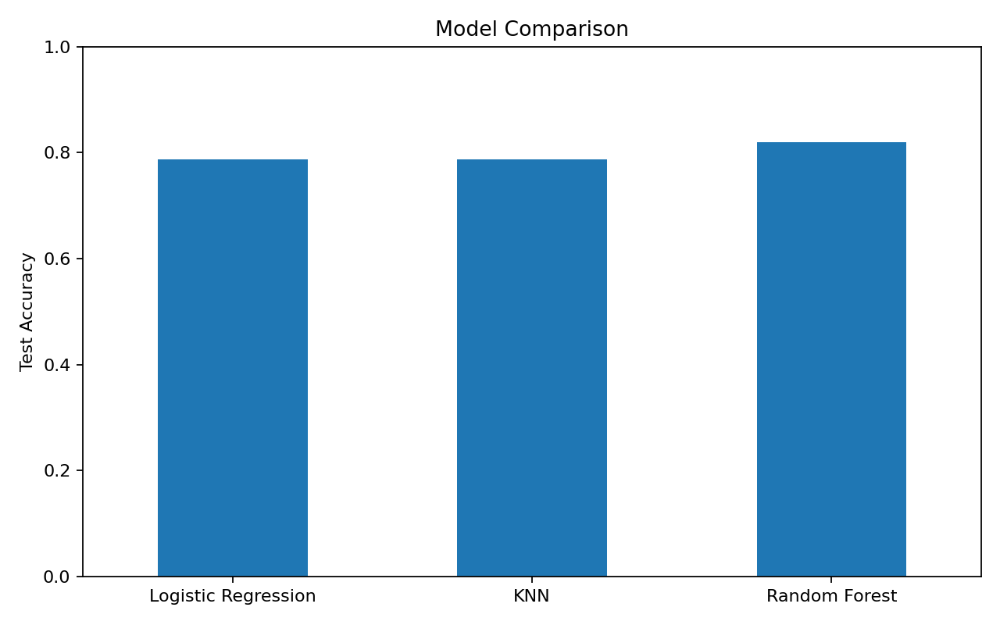
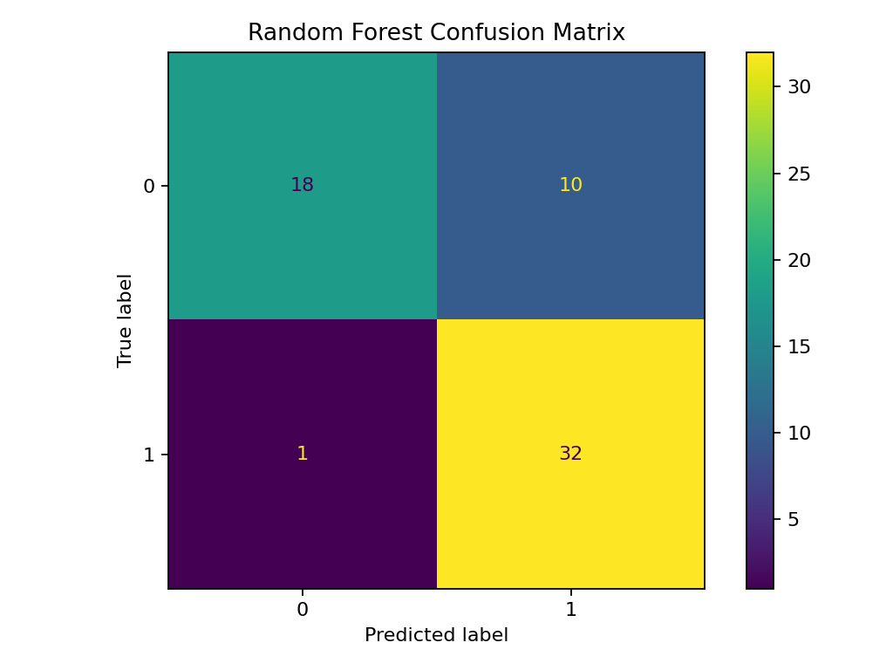
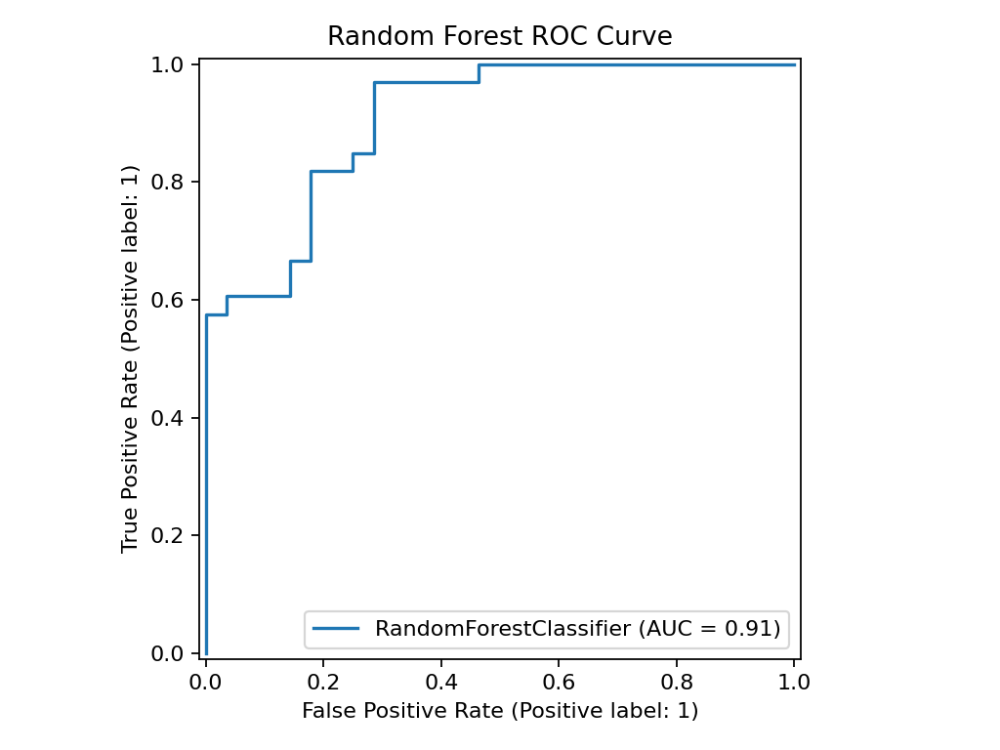
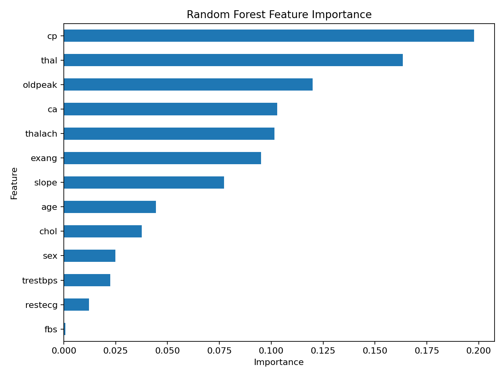

# Heart Disease Prediction with Machine Learning


End-to-end binary classification project for predicting the presence of heart disease from patient clinical attributes.

**Best model:** Random Forest  
**Test accuracy:** 81.97%  
**Recall:** 96.97%  
**ROC-AUC:** 90.69%

[Open the analysis notebook](notebooks/heart_disease_analysis.ipynb)

## Project goal

Predict the binary target:

- `0` — no heart disease
- `1` — heart disease

The project demonstrates a complete machine-learning workflow: exploratory data analysis, preprocessing, model comparison, hyperparameter tuning, cross-validation, evaluation, feature importance, error analysis, and model persistence.

## Dataset

The project uses the **Heart Disease** dataset, based on the Cleveland subset from the UCI Machine Learning Repository.

**Source:** [UCI Machine Learning Repository — Heart Disease](https://archive.ics.uci.edu/dataset/45/heart+disease)

The dataset used here contains **303 observations**, **13 input features**, and one target variable.

| Feature | Description |
|---|---|
| `age` | Age |
| `sex` | Sex |
| `cp` | Chest pain type |
| `trestbps` | Resting blood pressure |
| `chol` | Serum cholesterol |
| `fbs` | Fasting blood sugar |
| `restecg` | Resting ECG result |
| `thalach` | Maximum heart rate achieved |
| `exang` | Exercise-induced angina |
| `oldpeak` | ST depression induced by exercise |
| `slope` | Slope of the peak exercise ST segment |
| `ca` | Number of major vessels |
| `thal` | Thallium stress test result |

## Workflow

1. Problem definition and target analysis
2. Exploratory data analysis
3. Missing-value and class-balance checks
4. Correlation analysis
5. Stratified train/test split
6. Baseline model comparison
7. Scaling with `Pipeline` for Logistic Regression and KNN
8. Hyperparameter tuning with `RandomizedSearchCV` and `GridSearchCV`
9. Model selection using cross-validation
10. Held-out test evaluation
11. Confusion matrix and ROC-AUC
12. Cross-validation of classification metrics
13. Random Forest feature importance
14. Error analysis
15. Model persistence with `joblib`

## Models

The following classifiers were compared:

- Logistic Regression
- K-Nearest Neighbors
- Random Forest

| Model | Best CV score | Test accuracy |
|---|---:|---:|
| Logistic Regression | 0.8474 | 0.7869 |
| KNN | 0.8144 | 0.7869 |
| Random Forest | **0.8516** | **0.8197** |

Random Forest achieved the strongest mean cross-validation score and was selected for detailed evaluation.

### Final Random Forest configuration

```python
RandomForestClassifier(
    n_estimators=750,
    max_depth=4,
    min_samples_split=14,
    min_samples_leaf=7,
    random_state=42
)
```

## Final test metrics

| Metric | Score |
|---|---:|
| Accuracy | 0.8197 |
| Precision | 0.7619 |
| Recall | **0.9697** |
| F1-score | 0.8533 |
| ROC-AUC | **0.9069** |

Confusion matrix:

```text
[[18, 10],
 [ 1, 32]]
```

The model correctly detected **32 of 33 positive cases** in the held-out test set, with one false negative and ten false positives.

## Visual results

### Model comparison



### Confusion matrix



### ROC curve



### Feature importance



## Cross-validation

5-fold stratified cross-validation on the training data:

| Metric | Mean | Std |
|---|---:|---:|
| Accuracy | 0.8180 | 0.0971 |
| Precision | 0.8172 | 0.0950 |
| Recall | 0.8632 | 0.0868 |
| F1-score | 0.8386 | 0.0867 |

The fold-to-fold variation is relatively large, which is consistent with the small dataset size. This is why the project reports both the held-out test result and cross-validation statistics instead of relying on a single accuracy value.

## Feature importance

Top Random Forest features:

| Feature | Importance |
|---|---:|
| `cp` | 0.1978 |
| `thal` | 0.1634 |
| `oldpeak` | 0.1199 |
| `ca` | 0.1028 |
| `thalach` | 0.1015 |
| `exang` | 0.0951 |

Feature importance describes how useful a feature was to this fitted Random Forest. It should **not** be interpreted as causality.

## Error analysis

The held-out test set contained:

- 50 correct predictions
- 10 false positives
- 1 false negative

The misclassified examples were also inspected using predicted probabilities. Most errors were not extremely confident predictions, which suggests overlap between the two classes in feature space.

## Skills demonstrated

- Python
- pandas / NumPy
- Matplotlib / Seaborn
- scikit-learn
- Exploratory Data Analysis
- Classification
- Pipelines and feature scaling
- Logistic Regression
- KNN
- Random Forest
- RandomizedSearchCV / GridSearchCV
- Stratified cross-validation
- Precision / Recall / F1
- ROC-AUC
- Feature importance
- Error analysis
- Model persistence with joblib

## Repository structure

```text
heart-disease-ml/
├── .github/
│   └── workflows/
│       └── ci.yml
├── data/
│   └── heart-disease.csv
├── models/
│   └── heart_disease_random_forest.joblib
├── notebooks/
│   └── heart_disease_analysis.ipynb
├── reports/
│   └── figures/
│       ├── confusion_matrix.png
│       ├── feature_importance.png
│       ├── model_comparison.png
│       └── roc_curve.png
├── src/
│   └── train.py
├── .gitignore
├── LICENSE
├── README.md
└── requirements.txt
```

## Installation

Clone the repository:

```bash
git clone https://github.com/yrysmadiev1-cell/heart-disease-ml.git
cd heart-disease-ml
```

Create a virtual environment:

```bash
python -m venv .venv
```

Windows:

```bash
.venv\Scripts\activate
```

macOS/Linux:

```bash
source .venv/bin/activate
```

Install dependencies:

```bash
pip install -r requirements.txt
```

## Run

Open the notebook:

```bash
jupyter notebook notebooks/heart_disease_analysis.ipynb
```

Or reproduce the final Random Forest training/evaluation from the command line:

```bash
python src/train.py
```

## Reproducibility

The train/test split and Random Forest use `random_state=42`. Hyperparameter search is performed only on the training data, while the test set is reserved for final evaluation.

## Limitations

- The dataset is small, so estimates vary noticeably between folds.
- The project has not been validated on an independent external cohort.
- Feature importance does not imply a causal medical relationship.
- The decision threshold was not clinically optimized.
- This project is for educational and portfolio purposes only and is **not intended for clinical decision-making**.

## Possible improvements

- Evaluate on a larger independent dataset
- Compare with XGBoost or CatBoost
- Use nested cross-validation for stricter model-selection evaluation
- Add permutation importance or SHAP
- Calibrate predicted probabilities
- Select a decision threshold on validation data based on an explicit objective

## License

The project code is released under the [MIT License](LICENSE). The dataset remains subject to the terms of its original source.
